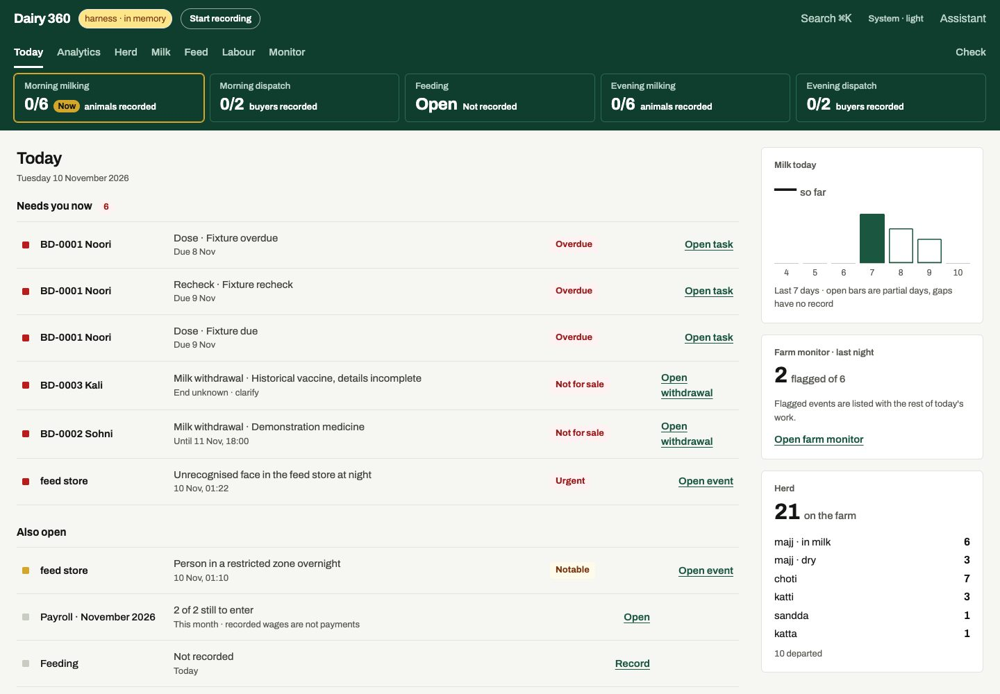
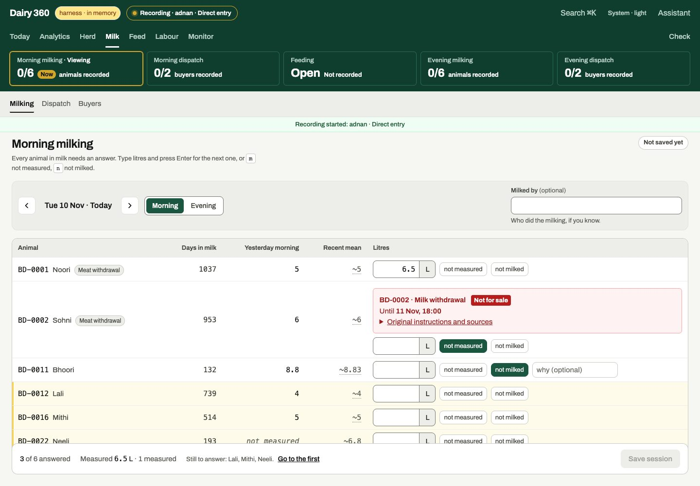
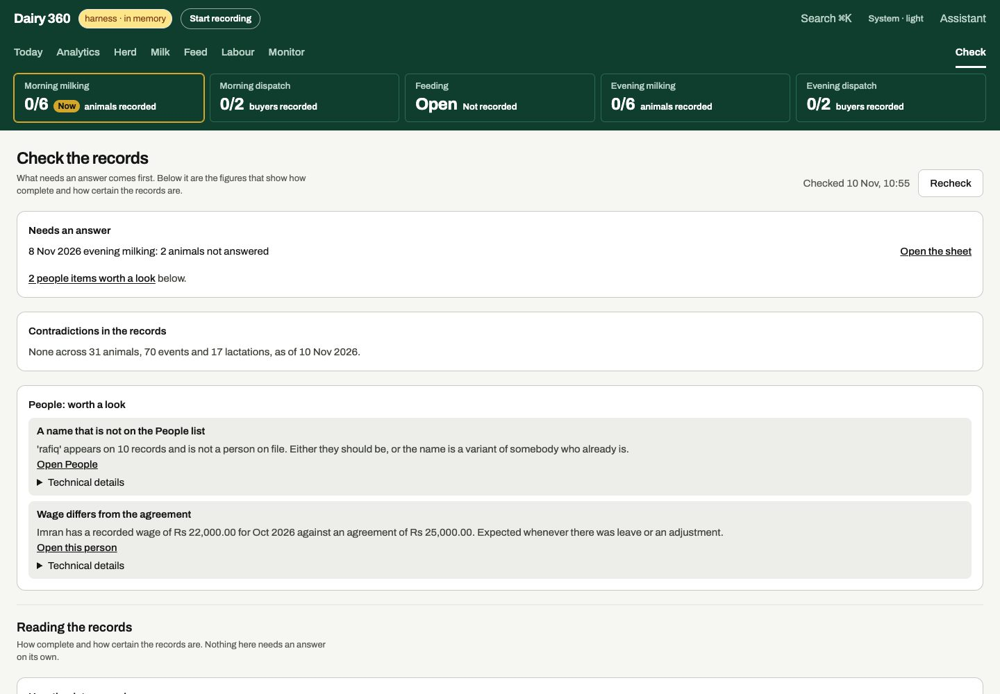
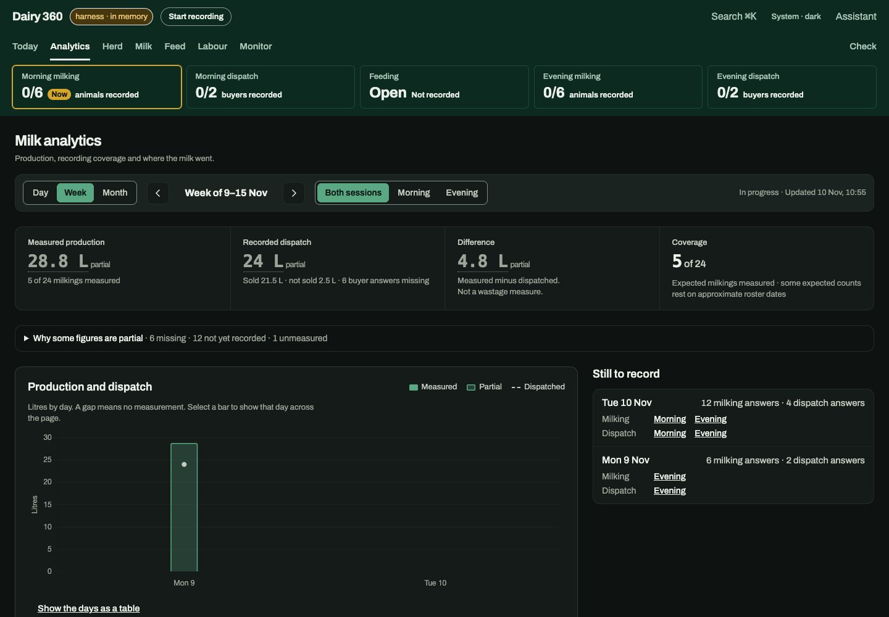
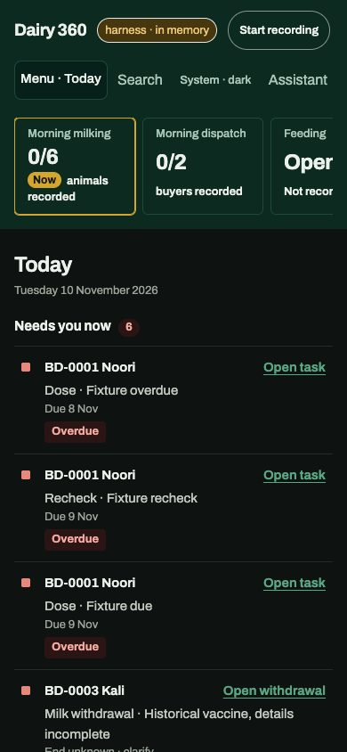
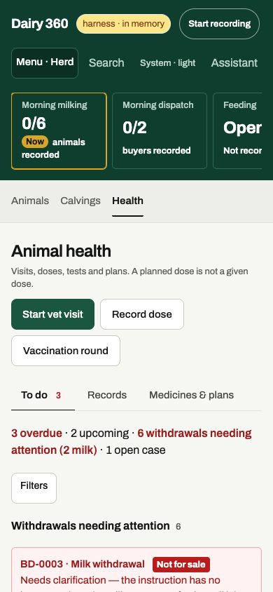

# Dairy 360

[](https://github.com/i-adnanali/dairy-360/actions/workflows/ci.yml)
[](LICENSE)

A local dairy-farm workspace for animal records, veterinary care, milk production and sales, feed, people and payroll, with an optional AI assistant that answers questions about the records.

Dairy 360 keeps uncertainty visible: approximate dates stay approximate, missing records stay distinct from zero, wages earned stay distinct from payments, and approval stays distinct from successful execution.



*Today, from the production build with synthetic, memory-only records. [Gallery and capture details](docs/images/current/README.md).*

[Quick start](#quick-start) · [Features](#features) · [Screenshots](#screenshots) · [Development](#development) · [Documentation](#documentation) · [Status and limitations](#status-and-limitations)

## Quick start

Requires Git, npm and **Node 22.22.3**, pinned in [`.nvmrc`](.nvmrc). Install once at the repository root.

```bash
git clone https://github.com/i-adnanali/dairy-360.git
cd dairy-360
nvm install
nvm use
npm ci
npm run harness:app
```

Open **http://localhost:6420**. This starts Angular and a synthetic registry backend on port 6400. No API key or farm database is needed; anything saved disappears when the harness stops. Press Ctrl+C to stop.

The harness serves every registry workflow but not assistant responses. For a larger analytics scenario, stop it and run `npm run harness:analytics`, then open `/analytics`. Both commands share ports with the persistent app.

### Persistent app and AI assistant

```bash
npm run build:shared
cp .env.example server/.env
# Edit server/.env: set ANTHROPIC_API_KEY for the assistant.
# Leave LANGFUSE_PUBLIC_KEY and LANGFUSE_SECRET_KEY empty unless configured.
npm run seed -w server
npm run dev:angular
```

The persistent server uses `server/dairy.db`; the registry and the assistant's demo tables are separate. `seed` resets the demo tables used by chat, preserves registry records, and is **not** a registry fixture loader. Registry agent tools are read-only; proposed agent writes target the demo domains, not registry records.

Read [setup and data boundaries](docs/guides/development.md) before using persistent data. Browsing needs nothing; saving needs a recording session that names who is typing and where the records come from. A root `.env` is needed only for optional camera Compose configuration. Langfuse is optional.

## Features

| Area | Capabilities |
|---|---|
| Today | One work board ranked by consequence: overdue health work, milk withdrawals, urgent camera events and late sessions first, then due-today work, payroll and feeding; a session board in the header for today's five sessions |
| Herd | Herd search and stage filters, calvings, event timelines, precision-aware corrections and provenance, lifetime reports |
| Health | Visits, doses, vaccination rounds, tasks, cases, plans and withdrawal instructions, on To do, Records and Medicines tabs |
| Milk | Per-animal session sheets answered by keyboard, sale and home dispatch, effective-dated rates, buyer balances and payments |
| Feed | Daily feeding accounts, crop lifecycles and expenses, purchases in original units and a feed catalogue |
| Labour | People, employment stints, salaried and daily wages, payments and signed adjustments |
| Analytics | Daily, weekly and monthly production and dispatch with coverage, partial figures marked, and links to what is still to record |
| Monitor | Camera events by window, flagged urgent or notable, with re-grading through the assistant on approval |
| Check | What needs an answer first, contradictions in the records with links to fix them, people notes, and how complete and certain the records are |
| Assistant | Streaming answers over the records, charts, expandable details and explicit approval and result receipts |

Every screen uses one visual language: an underline for where you are, a filled segment for what is chosen, amber only for "needs your answer" or "due now", red for overdue or not for sale, and figures written to show how they were known. See the [design system](docs/reference/ui/design-system.md).

## Screenshots

Production build, synthetic records, desktop 1440×1000 and phone-width browser 390×844 (not native-device acceptance). Long pages continue below the viewport.

<details>
<summary>Milking sheet while recording</summary>



</details>

<details>
<summary>Check the records</summary>



</details>

<details>
<summary>Weekly analytics, dark theme</summary>



</details>

<details>
<summary>Today and Health at phone width</summary>

 

</details>

[All screenshots](docs/images/current/README.md)

## Architecture

```text
dairy-360/
├── web-angular/  Angular 22, standalone components, signals, Tailwind, Chart.js
├── server/       Express, TypeScript, SQLite, agent loop and registry APIs
├── shared/       Shared domain and transport types
├── scripts/      Local harness, verification and capture utilities
└── docs/         Guides, references, architecture and dated records
```

The Angular app uses `/api/registry` for operational records and `/api/agent/run` for AG-UI streaming over SSE. The optional assistant routes each turn to dairy, vendor/sales, or both agents in one server process. Read tools run automatically; proposed writes pause for approval. Model-facing digests remain separate from chart datasets.

Camera-event ingestion and classification and self-hosted Langfuse tracing are optional integrations. See [architecture](docs/architecture/system.md), [agent internals](docs/architecture/assistant.md) and [integration operations](docs/guides/camera-operations.md).

## Development

Run from the repository root after `nvm use` and `npm ci`:

```bash
npm run build:shared
npm run typecheck
npm test -w server
npm test -w web-angular -- --watch=false
npm run check:docs
npm run check:templates
npm run check:contrast
npm run build:angular
```

The frontend build is written to `web-angular/dist/web-angular/browser`. To serve it against a running memory harness on 6400, run `npm run harness:serve` and open http://localhost:6430.

Unit suites need no API key or farm database. Live-model regression tests are separate, need credentials and spend API tokens; a skipped live run is not a pass. See [testing](docs/guides/testing.md), and [acceptance status](docs/reference/ui/acceptance-status.md) for the latest recorded results.

## Documentation

| Need | Guide |
|---|---|
| Documentation map | [Docs index](docs/README.md) |
| Setup, troubleshooting, CLI and backups | [Development](docs/guides/development.md), [CLI](docs/guides/registry-cli.md), [backup/restore](docs/guides/backup-restore.md) |
| How the UI looks and behaves | [Design system](docs/reference/ui/design-system.md), [interaction contracts](docs/reference/ui/application-interactions.md) |
| Animals and corrections | [Registry](docs/reference/registry/animals.md) |
| Milk recording and sales | [Milking](docs/reference/registry/milking.md), [sales](docs/reference/registry/sales.md) |
| Feed, health and labour | [Feed](docs/reference/registry/feed.md), [health](docs/reference/registry/health.md), [payroll](docs/reference/registry/payroll.md) |
| Metrics and uncertainty | [Analytics specification](docs/reference/registry/analytics.md) |
| Optional integrations | [Camera operations](docs/guides/camera-operations.md), [tracing](docs/guides/observability.md) |
| Remaining work | [Open items](docs/OPEN.md), [acceptance status](docs/reference/ui/acceptance-status.md) |

## Status and limitations

This is a local, single-user application without authentication or multi-user tenancy, and it is not production-hardened. Registry HTTP retry protections do not provide cross-request replay protection for assistant demo writes. No real herd data has been entered yet, and real-farm operator trials and live assistant acceptance have not been run. Some platform checks were skipped by decision rather than passed; [acceptance status](docs/reference/ui/acceptance-status.md) lists them.

## Contributing

Open an issue with a reproducible problem or proposed scope, then submit a focused pull request. Use synthetic data, keep domain uncertainty and write protections, run the checks above, and update the owning reference page. Never commit database files, uploads, credentials or real farm records. See [development conventions](docs/guides/development.md) and the [design system](docs/reference/ui/design-system.md).

## License

[MIT](LICENSE) © 2026 Adnan Ali.
